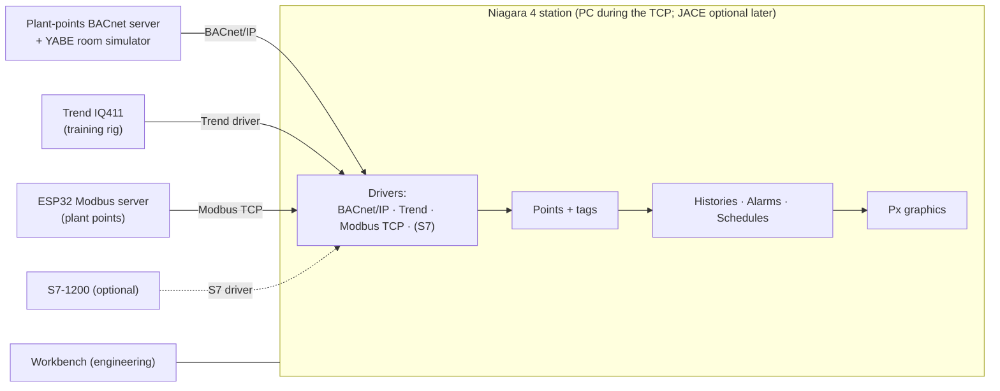

# Niagara / Tridium Familiarisation: The Portfolio Seen from a Real BMS Supervisor (Design Stage)

**Learning Niagara 4 the way an integrator uses it: a station that brings in the portfolio's own devices over three drivers (BACnet/IP, Trend and Modbus TCP), with histories, alarms, schedules and Px graphics built on top, then the Home Assistant + Node-RED supervisory layer mapped onto Niagara's concepts. The route in is the Niagara 4 Technical Certification Program (TCP), which also brings the credential UK BMS employers ask for.**

> **The short version:**
> - **Route:** the **Niagara 4 TCP** course (software access during training, then certification); a used JACE is optional, later.
> - **Devices it will integrate**, all from this portfolio: the [plant-points BACnet server](https://github.com/the-control-cabinet/plant-points-bacnet-server) and YABE's simulator (**BACnet/IP**), the [Trend IQ411](https://github.com/the-control-cabinet/trend-iq411-commissioning) (**Trend driver**), the [ESP32 Modbus server](https://github.com/the-control-cabinet/esp32-modbus-server-plant-points) (**Modbus TCP**), and optionally an S7-1200 from the [PLC project](https://github.com/the-control-cabinet/plc-reimplementation-iec61131).
> - **Built on top:** points with tagging, **histories**, **alarms** with routing, **schedules** and **Px graphics**.
> - **The comparison:** the same supervisory jobs in Home Assistant + Node-RED and in Niagara, side by side.

**Portfolio position:** Stage 4 · #14 (supervisory platforms). Builds on: [BACnet/IP explorer](https://github.com/the-control-cabinet/bacnet-ip-network-explorer) · [HA + Node-RED supervisory layer](https://github.com/the-control-cabinet/ha-node-red-supervisory-layer) · [alarm and trend strategy](https://github.com/the-control-cabinet/alarm-and-trend-strategy) · [semantic tagging](https://github.com/the-control-cabinet/haystack-semantic-tagging)

---

## Status at a glance

| Item | Status |
|---|---|
| Niagara concepts and architecture (station, Workbench, drivers, JACE vs supervisor) | 📐 Drafted ([doc 01](docs/01-architecture-and-concepts.md)) |
| Lab plan: drivers, points, histories, alarms, schedules, graphics | 📐 Drafted ([doc 02](docs/02-lab-plan.md)) |
| HA + Node-RED ↔ Niagara concept map | 📐 Drafted ([doc 03](docs/03-ha-node-red-vs-niagara.md)) |
| Device and point plan | 📐 Drafted ([data/driver-and-point-plan.csv](data/driver-and-point-plan.csv)) |
| Devices to integrate | 🚧 BACnet simulator ✅ (YABE) · plant-points server, IQ411, Modbus server ⏳ |
| Software access (Niagara 4 TCP) | ⏳ To book |

## Why Niagara

Niagara (developed by Tridium, now part of Honeywell) is one of the most widely used open supervisory frameworks in commercial buildings: the same software runs on embedded controllers (JACEs) and on supervisor servers, and many manufacturers ship it under their own brand. An integrator's day is often spent in Workbench: discovering devices over a driver, turning points into tagged, historised, alarmed objects, and building the graphics operators use. Doing that with **devices I've built or commissioned myself** shows the whole chain, from the I/O to the head end.

## Architecture

- **Read-only first:** every driver starts with reads; writes (setpoints, commands) only on the rig and simulators, never on the house's live heating.
- **Local network only.**

## Labs (summary; full plan in [doc 02](docs/02-lab-plan.md))

| # | Lab | Uses |
|---|---|---|
| 1 | Station set-up, Workbench, platform basics, users and roles | Niagara 4 (TCP) |
| 2 | BACnet/IP driver: discover YABE's simulator, then the plant-points server; points, units, COV | [BACnet explorer](https://github.com/the-control-cabinet/bacnet-ip-network-explorer) · [plant-points server](https://github.com/the-control-cabinet/plant-points-bacnet-server) |
| 3 | Trend driver to the IQ411: its I/O and strategy points | [Trend IQ411](https://github.com/the-control-cabinet/trend-iq411-commissioning) |
| 4 | Modbus TCP driver: the ESP32 register map | [ESP32 Modbus server](https://github.com/the-control-cabinet/esp32-modbus-server-plant-points) |
| 5 | Tagging, histories and trend charts | [semantic tagging](https://github.com/the-control-cabinet/haystack-semantic-tagging) · [alarm and trend strategy](https://github.com/the-control-cabinet/alarm-and-trend-strategy) |
| 6 | Alarms: classes, priorities, routing, acknowledgement | alarm and trend strategy |
| 7 | Schedules: weekly and exception schedules on simulator and rig points | [optimum start/stop](https://github.com/the-control-cabinet/optimum-start-stop-supervisory) |
| 8 | Px graphics: a plant-room page in the style of the HA version | [plant-room graphics](https://github.com/the-control-cabinet/plant-room-graphics-hmi) |
| 9 | Optional: S7 driver to a physical S7-1200 | [PLC re-implementation](https://github.com/the-control-cabinet/plc-reimplementation-iec61131) |

## Documents

| Doc | Contents |
|---|---|
| [01 Architecture and concepts](docs/01-architecture-and-concepts.md) | Station, Workbench, platform, drivers, component model, JACE vs supervisor, licensing |
| [02 Lab plan](docs/02-lab-plan.md) | Each lab's steps, evidence to capture and pass criteria |
| [03 HA + Node-RED vs Niagara](docs/03-ha-node-red-vs-niagara.md) | The same supervisory jobs on both platforms |

## Roadmap
- [ ] Book the Niagara 4 TCP (software access + certification)
- [ ] Lab 1: station and Workbench
- [ ] Lab 2: BACnet/IP (YABE simulator, then the plant-points server)
- [ ] Labs 3-4: Trend and Modbus TCP drivers (as those projects reach hardware)
- [ ] Labs 5-8: histories, alarms, schedules, Px graphics
- [ ] Comparison write-up with the HA + Node-RED layer
- [ ] Optional: a used JACE; the S7 driver (lab 9)

## Skills demonstrated (as built)
| Skill | Evidence |
|---|---|
| Niagara 4 station engineering | Station, drivers, points, services |
| Multi-protocol integration | BACnet/IP, Trend, Modbus TCP (S7 optional) under one supervisor |
| Supervisory functions | Histories, alarms, schedules, graphics |
| Platform comparison | HA + Node-RED vs Niagara for the same jobs |

📺 [The Control Cabinet on YouTube](https://www.youtube.com/channel/UC5Cupmz7vlfcodpCX7k8iuQ)

*Built and documented by James · part of [The Control Cabinet BMS portfolio](https://github.com/the-control-cabinet/the-control-cabinet). MIT Licence.*
